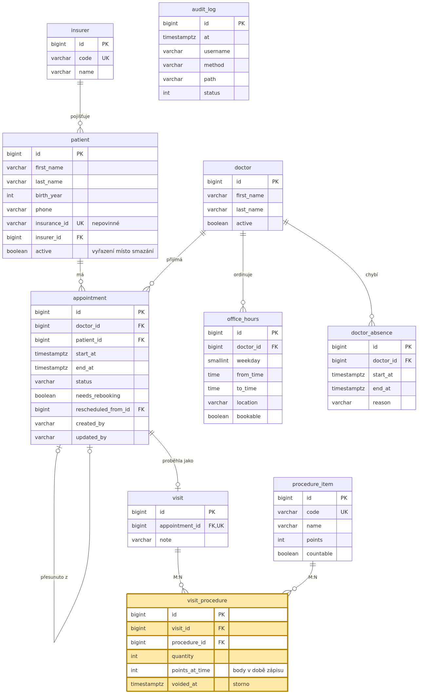
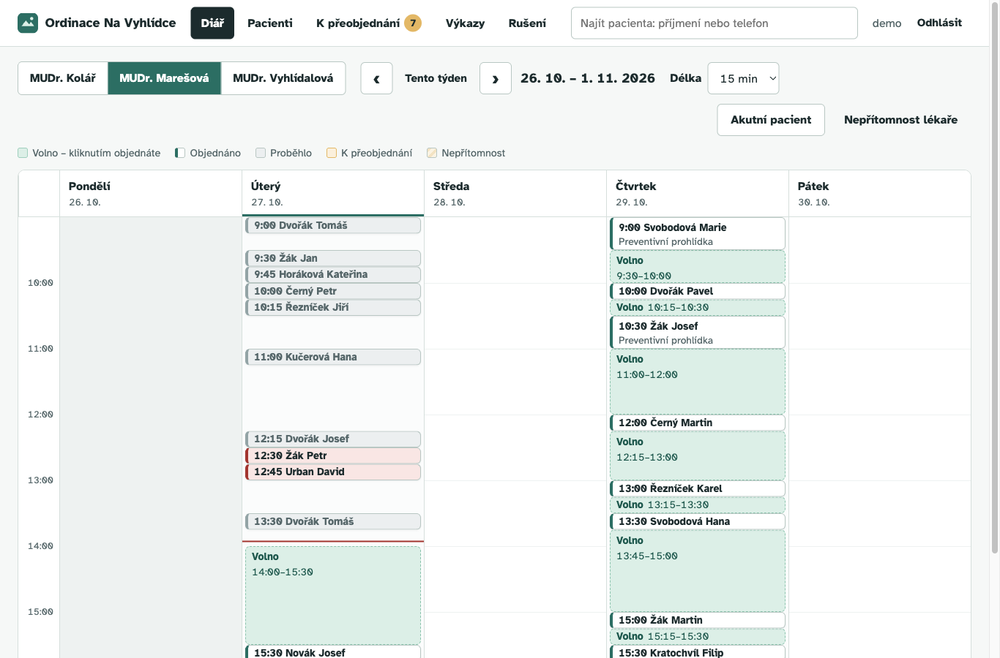
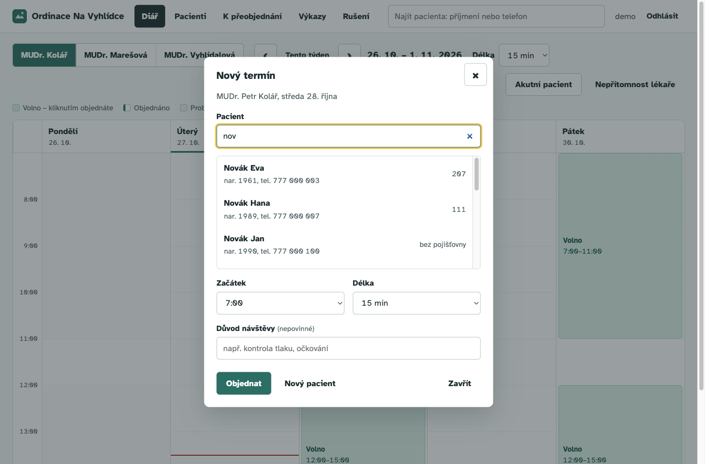
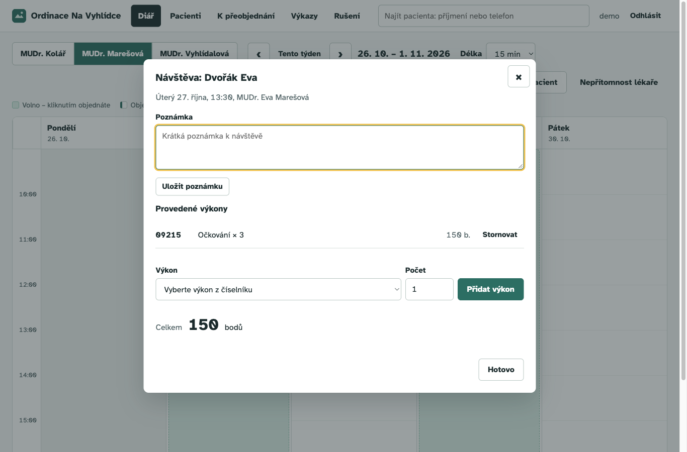
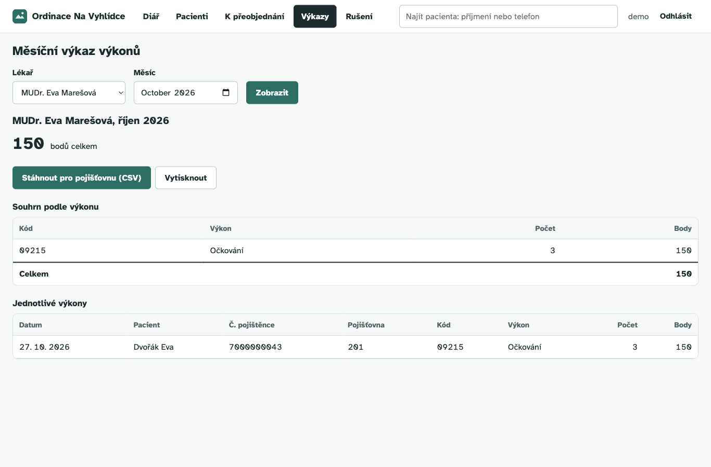
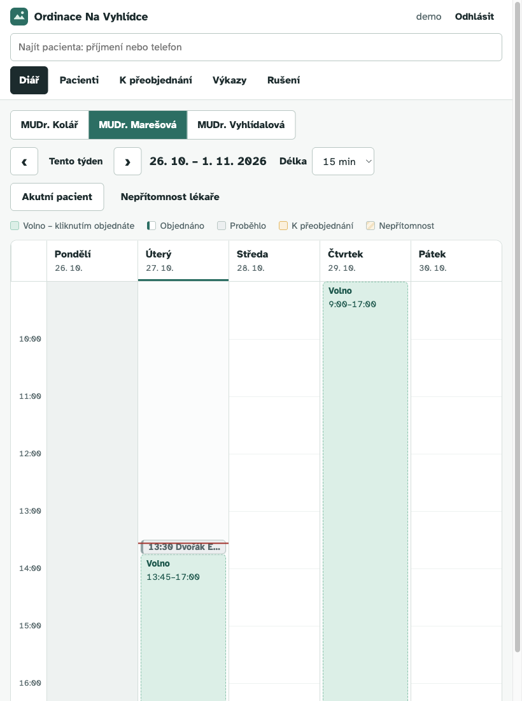

# Úvod

Ordinace Na Vyhlídce je soukromá praxe se třemi lékaři na částečný úvazek a jednou recepční. Dosud se objednávalo do papírového diáře, volné termíny se hledaly listováním a výkony pro pojišťovnu se na konci měsíce ručně přepisovaly do tabulky. Dvakrát za rok se stalo, že na stejný čas byli objednaní dva pacienti.

Aplikace tyto činnosti nahrazuje webovým systémem pro recepci:

- týdenní diář lékaře s volnými okny, objednání jedním kliknutím,
- rušení, přesun a evidence nedostavení se, přehled pacientů, kteří ruší opakovaně,
- evidence pacientů s hlídáním duplicit,
- zápis návštěvy a provedených výkonů z číselníku,
- nepřítomnost lékaře a seznam rezervací k přeobjednání,
- měsíční výkaz výkonů a bodů pro pojišťovnu (obrazovka, tisk, CSV).

Klíčová pravidla klienta vynucuje aplikace i databáze: dvě rezervace se nepřekryjí, mimo ordinační hodiny objednat nejde, výkon nelze zapsat před začátkem návštěvy a historie pacienta se nemaže.

# Datový model

Schéma je ve verzovaných migracích Flyway (`src/main/resources/db/migration`): V1 schéma, V2 číselníky a syntetická data, V3 audit přístupů.

| Entita | Význam |
|---|---|
| `insurer` | číselník zdravotních pojišťoven |
| `patient` | pacient, volitelně s číslem pojištěnce a pojišťovnou |
| `doctor` | lékař |
| `office_hours` | týdenní šablona ordinačních hodin (den, od–do, místo, zda se objednává) |
| `doctor_absence` | nepřítomnost lékaře (časový interval) |
| `appointment` | rezervace pacienta u lékaře, stav, odkaz na původní rezervaci při přesunu |
| `visit` | uskutečněná návštěva (1:1 k rezervaci) |
| `procedure_item` | číselník výkonů (kód, název, body, zda se zadává počet) |
| `visit_procedure` | **vazba M:N** návštěva–výkon s atributy `quantity`, `points_at_time`, `voided_at` |
| `audit_log` | záznam přístupů k osobním údajům |

**Vazba M:N.** Na jedné návštěvě proběhne více výkonů a tentýž výkon se opakuje u mnoha návštěv. Spojovací tabulka `visit_procedure` nese vlastní atributy: počet, body zmražené v době zápisu (změna ceníku neovlivní minulé výkazy) a čas storna.



> TODO: vložit ER diagram (např. export z DBeaveru nebo dbdiagram.io) jako `docs/er-diagram.png`.

**Integritní omezení v databázi:**

- `EXCLUDE USING gist (doctor_id WITH =, tstzrange(start_at, end_at) WITH &&)` pro aktivní stavy znamená, že lékař nemá dvě překrývající se rezervace. Totéž platí pro pacienta.
- `CHECK (end_at > start_at)` u rezervací, absencí a ordinačních hodin.
- `UNIQUE (insurance_id)`. Číslo pojištěnce je nepovinné, ale nesmí se opakovat.
- Částečný unikátní index `(visit_id, procedure_id) WHERE voided_at IS NULL`: jeden aktivní zápis výkonu na návštěvu.
- `CHECK (quantity >= 1)`, `CHECK (phone ~ '^[0-9]+$')` a další.

# Architektura

Aplikace je třívrstvá a závislosti vedou jen jedním směrem:

```
prohlížeč (HTML/CSS/JS)  --REST/JSON-->  api (controllery, DTO)
                                            |
                                            v
                                       service (pravidla, transakce)
                                            |
                                            v
                                       repository (Spring Data JPA)  -->  PostgreSQL
```

Kód je rozdělený do balíčků podle funkce (`patient`, `doctor`, `appointment`, `visit`, `audit`, `gdpr`, `security`) a uvnitř nich podle vrstev. Controller neobsahuje SQL ani logiku. Jen převádí požadavek na volání služby a výsledek na DTO (Java `record`).

**Jak je směr závislostí hlídaný.** Test `LayersTest` (ArchUnit) při každém buildu ověří, že balíčky `api` nesahají na `repository` ani na JPA/JDBC, `service` nezávisí na `api` a `repository` nezávisí na vyšších vrstvách. Porušení shodí `./mvnw verify` i CI. Při zavedení testu se tak našly dva záznamy z dotazů (`CancellationStat`, `ReportLine`), které ležely v `repository` a používal je controller. Přesunuly se do `dto`.

**Pravidla ve službě a v databázi.** `AppointmentService` před uložením ověří délku, ordinační hodiny, nepřítomnost lékaře a kolize. Databáze tatáž pravidla drží znovu, takže když se dva požadavky na stejný termín potkají současně, uspěje jen jeden. Druhý skončí výjimkou z constraintu, kterou `ApiExceptionHandler` převede na 409. Test `AppointmentConcurrencyIT` to ověřuje dvěma vlákny.

**Čas.** Služby dostávají `java.time.Clock` (Europe/Prague), takže testy mohou čas zafixovat. Časy se ukládají jako `TIMESTAMPTZ`. Test `sameLocalTimeIsAcceptedBeforeAndAfterDaylightSavingChange` hlídá přechod na zimní čas.

**Volné termíny.** `TimeRange.free` vezme bookovatelné intervaly týdne a odečte rezervace, nepřítomnosti a uplynulý čas. Vrací souvislá okna, do kterých se vejde zvolená délka.

**Chyby.** Výjimky se mapují na `application/problem+json`: `NotFoundException` na 404, `ConflictException` na 409 (případně s `existingId` duplicitního pacienta), `BusinessRuleException` na 422. Rozhraní je překládá do češtiny.

**Bezpečnost a GDPR.** Spring Security s přihlašovacím formulářem, CSRF tokenem v cookie, Content-Security-Policy bez inline skriptů a vypršením relace po 30 minutách. `AuditInterceptor` zapisuje každé volání API s osobními údaji do `audit_log` a `LoginEvents` tam zapisuje i každý pokus o přihlášení. Tabulka `audit_log` jde jen doplňovat: úpravu, smazání i `TRUNCATE` odmítne trigger v databázi (migrace V4). U rezervace se ukládá, kdo ji založil a kdo ji naposledy změnil (`@CreatedBy`/`@LastModifiedBy` ze Spring Data, hodnotu dodá přihlášený uživatel). Po pěti špatných heslech se jméno na 5 minut zablokuje (`LoginAttempts`). Zamyká se i neexistující jméno, aby se podle hlášky nedalo poznat, které účty existují. Hesla v `APP_USERS` mohou být uložená jako bcrypt hash. Kontejner aplikace běží pod neprivilegovaným uživatelem, s jen pro čtení souborovým systémem, bez linuxových oprávnění (`cap_drop: ALL`) a s `no-new-privileges`. Export údajů pacienta (`/api/patients/{id}/export`) slouží pro žádosti podle čl. 15 a 20 GDPR.

# Uživatelské rozhraní

Rozhraní je určené recepční, která „s počítačem moc nekamarádí“: velké ovládací prvky (min. 44 px), písmo Atkinson Hyperlegible navržené pro snadné čtení, hledání pacienta vždy po ruce v horní liště a srozumitelné české hlášky místo technických chyb.

{ width=100% }

{ width=100% }

{ width=100% }

{ width=100% }

{ width=60% }

# Použité technologie

| Technologie | Proč |
|---|---|
| Java 21, Spring Boot 3.4 | records pro DTO, konstruktorová injekce, ověřený ekosystém |
| Spring Data JPA, Hibernate | repozitáře bez ručního SQL tam, kde stačí odvozené dotazy |
| PostgreSQL 16 | exclusion constraint nad časovými intervaly (`btree_gist`), `unaccent` pro hledání bez diakritiky |
| Flyway | verzované migrace, stejné schéma v Dockeru i v testech |
| Spring Security | přihlášení, CSRF, bezpečnostní hlavičky |
| HTML, CSS, JavaScript (bez frameworku) | jedna stránka bez buildu, rychlé načtení na recepčním počítači |
| JUnit 5, AssertJ, Mockito, Testcontainers | jednotkové a integrační testy proti skutečné PostgreSQL |
| ArchUnit | test, který hlídá směr závislostí mezi vrstvami |
| JaCoCo | měření pokrytí kódu testy, report v CI |
| Playwright | prohlížečové testy hlavních scénářů (desktop i tablet) a nahraná prohlídka pro klienta |
| Docker Compose, GitHub Actions | spuštění jedním příkazem, CI při každém pushi |
| gitleaks, Grype | v CI hledají hesla v historii repozitáře a známé zranitelnosti v Docker image |

# Spuštění

```bash
cp .env.example .env      # nastavit hesla a účty v APP_USERS
docker compose up --build -d
```

Aplikace běží na `http://localhost:8080`. Podrobnosti a proměnné prostředí jsou v `README.md`.

# Testy

- **Jednotkové testy** (`*Test`) testují aplikační logiku s mocky na hranicích: `AppointmentServiceTest` (ordinační hodiny, polední pauza, minulost, absence, kolize, přesun, no-show, DST, volné termíny), `TimeRangeTest`, `VisitServiceTest`, `MonthlyReportTest`, `PatientServiceTest`, `DoctorServiceTest`, `PhoneNumbersTest`, `LoginAttemptsTest` (zámek po špatných heslech a jeho vypršení). `LayersTest` (ArchUnit) hlídá vrstvy.
- **Integrační testy** (`*IT`) běží proti PostgreSQL v Testcontainers: překryvy a constrainty přímo v DB (`SchemaConstraintsIT`), API rezervací, souběžné objednání (`AppointmentConcurrencyIT`), návštěva, výkaz a CSV (`VisitApiIT`), přihlášení, zablokování po špatných heslech, CSRF, audit a export (`SecurityIT`), audit, který nejde upravit ani smazat (`SchemaConstraintsIT`).
- **Prohlížečové testy** (`e2e/`, Playwright): přihlášení a odhlášení, objednání a zrušení z diáře, přesun termínu, nový pacient a hlídání duplicity, výkaz, rozpis dne.

Spuštění: `./mvnw verify` (pokrytí pak v `target/site/jacoco/index.html`). Pro E2E viz README. CI v GitHub Actions spouští při každém pushi a pull requestu obojí. Navíc vypíše pokrytí do souhrnu běhu, prohledá historii na hesla (gitleaks), Docker image na opravitelné vysoké a kritické zranitelnosti (Grype) a ověří, že `dokumentace.pdf` není starší než `dokumentace.md`.

> TODO: doplnit počty testů a výsledek posledního běhu CI (screenshot).

# Protokol o zacyklení agenta

> TODO (vlastními slovy, 1 strana): konkrétní situace, kdy se agent zasekl nebo dával nefunkční výstup, jak jsem to poznal, co jsem zkusil a jak se to vyřešilo. Podklady sbírám průběžně (viz CLAUDE.md).

# Přiznání práce s AI

> TODO (vlastními slovy): které části vznikly s pomocí AI (Claude Code), jak jsem výstup kontroloval a upravoval a co jsem psal sám.
